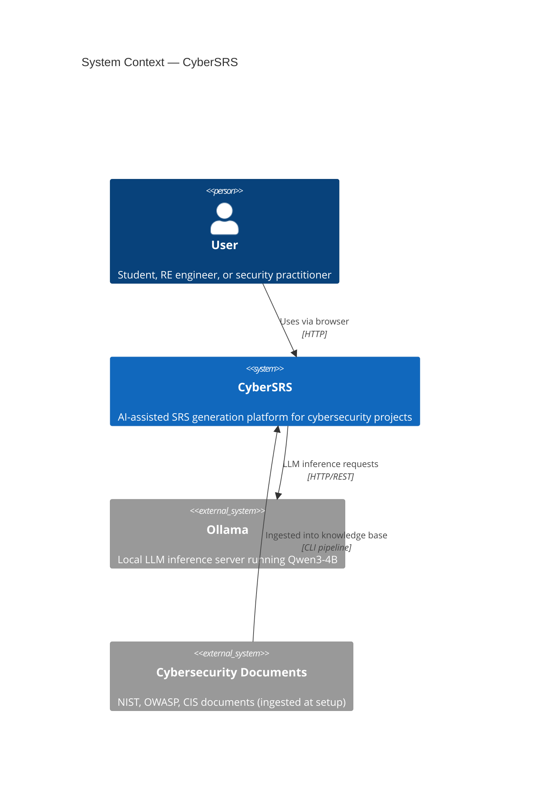
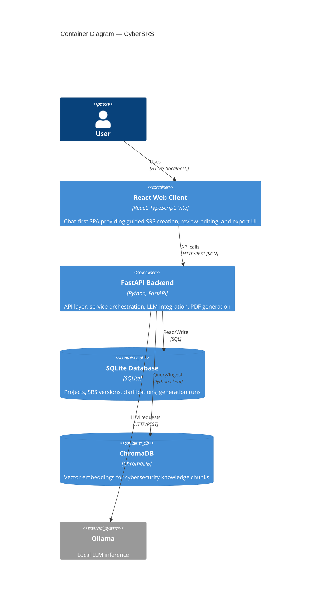
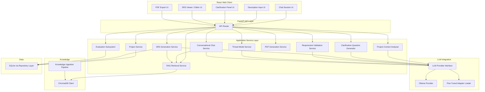
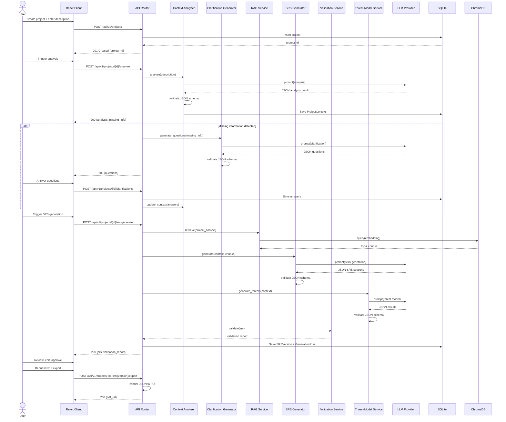
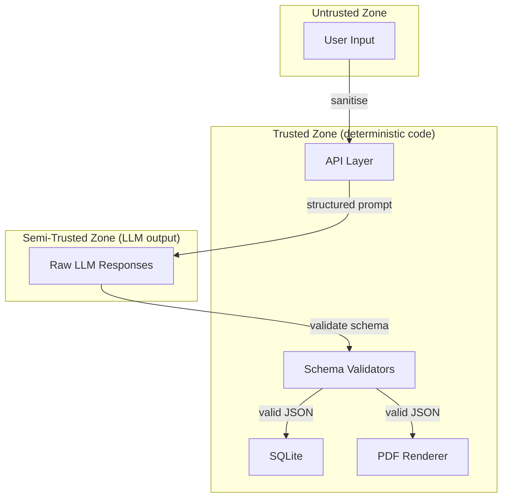

# System Architecture — CyberSRS

## Semantic hardening in progress (ADR-0022)

`source_evidence_graph` builds typed facts and scoped decisions from verbatim
description/answer spans, independently of model-extracted context. Relational
quantities keep planning population, observation windows and response deadlines
distinct. The legacy ledger receives additional source facts for existing
obligation compilation; a compact semantic contract accompanies model prompts.

`source_coverage_service` independently audits normative representations against
effective source facts and projects planning/business evidence into explicit
`project_constraints`. `semantic_contract_service` inspects requirement details
and supporting document fields for unsupported quantities, technology choices
and source-lock contradictions. These findings feed quality caps and blockers.
Rendering and repair preserve structured verification and separate rendered
evidence/pass-condition suffixes from the expected behavioral result.

The local bundle path now uses a validated requirement-only collection between
requirements inference and supporting inference. Shared classification and
deduplication run before an ID/fingerprint snapshot is produced; source obligations
are completed before that freeze. Supporting schemas constrain links to those IDs.
Known retired aliases may be rewritten, but unknown links require targeted model
correction. Post-supporting ID changes are hard validation failures. Canonical
advisory labels replace crude numeric/technology text substitution on this path.

This implementation is partial. Late-repair rebuilding, the broader behavioral
and threat contract, citation entailment, lifecycle overlays and end-to-end local
model acceptance remain governed by the unchecked hardening acceptance matrix.

Workflow evidence now distinguishes manual/automatic modes, incident/ticket
targets and role scope. The document guard also interprets out-of-scope headings;
TBD cannot silently become an exclusion. `interaction_semantics` recognizes
explicit human behavior using roles from the authoritative source graph. Story
projection works across canonical requirement categories, omits background
controls, preserves actor source keys and separates known success/failure details
from unresolved business flows. These gaps reduce quality; they are not completed
by copying test-environment boilerplate. Full behavioral scenario generation is
still pending. Quality status remains invalid whenever a hard blocker exists,
including when another warning already applied a score cap.

Real local inference exposed additional input-boundary defects. Prompt compaction
now derives entities/roles from source facts and omits model-inferred goals,
constraints and stakeholders as authoritative facts. Foundation source validation
runs before dependent inference. Its native JSON grammar and Pydantic validator
preserve the exact explicit exclusion array; uncertain scope decisions remain
uncertain. Clause splitting resolves contrasts before conjunctions to prevent an
earlier affirmative predicate from approving a later negative noun list.

`source_actor_service` binds recognized roles to local actions, including shared
subjects, coordinated verbs, plural/abbreviated names and permission polarity.
Facts carry actor roles/action/effect; ledger projection, canonical compilation,
source completeness, contradiction checks and story projection use that binding.
Mentioning a role in an object or a different action is insufficient. Lower-ranked
noun shorthand does not widen a higher-ranked network-administrator scope; explicit
new actor/action clauses remain independently audited. Original spans are retained.
Configuration-change verification compares submitted and read-back state instead
of repeating the requirement as its pass condition. Other behavioral test paths
still need the complete positive/negative/boundary generation contract.

ADR-0023 adds explicit pending status to newly generated architecture designs
and risk mitigations through `supporting_design_service`. Compact bundles cannot
assert approval; historical documents retain no status and their existing strict
audit. Preview, Markdown and PDF preserve the pending labels. The source contract
checks exclusions, permissions, explicit dispositions and workflow conflicts even
inside advisory content; only candidate specificity is exempted from mandatory
value/technology checks. A risk mitigation's status does not exempt its description.

## Current professor-brief completion (ADR-0021)

Networking/cybersecurity is the adopted domain. Three compact Ollama bundles
author the foundation, requirements with acceptance criteria, and supporting
content. Category minima no longer force filler and normalization does not
silently slice valid model requirements. Continuation and targeted repair retain
validated fields; repair prompts use the compact evidence contract.

After the existing evidence/citation/verification gates, deterministic linked
story/use-case projections and overlapping dimensions are rebuilt from final
requirements. Local human decisions are append-only records bound to the exact
SRS hash, outside immutable requirement content. UI/PDF/Markdown/JSON expose the
same artifacts. Local model/embedding endpoints are restricted to loopback.

Lifecycle factors come from authoritative user text and substantive answers.
Versioned deterministic rules rank the allowed methodologies, preserving unknowns,
exclusions and conflicts. Base Qwen explains the top candidate, and its selected
label is checked against that rank. Deterministic expansion links every source
requirement to a methodology-specific advisory workflow and human gates. These
scores are heuristic suitability measures, not probabilities or certified advice.

Earlier phase descriptions below are historical when superseded by this section
or ADR-0021. See `PROBLEM_STATEMENT_ALIGNMENT.md` for adopted scope and evidence.

**Version:** 0.1.0-draft
**Date:** 2026-08-07
**Status:** Phase 0 — Planning

---

## 1. Architectural Style

CyberSRS is a **modular monolith** — a single deployable application with clearly separated internal service modules. This choice keeps deployment simple (single machine, one student developer) while maintaining separation of concerns for testability and future refactoring.

There are no microservices. All backend modules run in a single FastAPI process. The React frontend is a separate build artifact served statically or via Vite dev server.

---

## 2. System-Context Diagram

**Boundaries:**
- The user interacts with CyberSRS through a web browser on localhost.
- CyberSRS communicates only with the local Ollama instance — no other external services.
- Cybersecurity documents are ingested offline via a CLI pipeline.

---

## 3. Container-Level Diagram

---

## 4. Major-Component Diagram

The live frontend is chat-first. `AppShell` owns navigation and runtime state, `ChatThread` and `Composer` own the conversation surface, and `SRSWorkspace` plus `SRSEditor` are the single live SRS component family. Feature components consume semantic CSS/Tailwind tokens and shared accessible primitives; legacy root-level SRS viewers are not part of the runtime graph.

The backend is organised into the following service modules:

### Component Descriptions

| Component | Responsibility | Type |
|---|---|---|
| **API Router** | HTTP request routing, input validation, response serialisation | Deterministic |
| **Project Service** | CRUD operations for projects and related entities | Deterministic |
| **Project-Context Analyser** | Calls the LLM to analyse descriptions, extract entities, infer subdomain | Generative |
| **Clarification-Question Generator** | Calls the LLM to produce clarification questions from detected gaps | Generative |
| **RAG Retrieval Service** | Constructs queries from project context, retrieves chunks from ChromaDB | Deterministic (retrieval) |
| **SRS Generation Service** | Orchestrates the generation of all SRS sections via the LLM with RAG context | Generative |
| **Requirement Validation Service** | Validates SRS for completeness, testability, consistency (mix of deterministic rules and LLM-assisted checks) | Hybrid |
| **Threat-Model Service** | Calls the LLM to generate threats and mitigations for the project | Generative |
| **PDF Generation Service** | Renders validated JSON into a PDF using templates | Deterministic |
| **Conversational Chat Service** | Classifies explicit workflow commands, retrieves local knowledge, and returns schema-validated answers with citations | Hybrid |
| **Task-Aware Provider Router** | Keeps general chat on the base Qwen model while routing requirements-engineering tasks to the configured base or fine-tuned variant | Deterministic |
| **Project Document Service** | Validates, stores, parses, chunks, indexes, lists, and deletes local project reference files | Deterministic |
| **Evaluation Subsystem** | Compares base-model and fine-tuned outputs on a reference dataset | Deterministic |
| **LLM Provider Interface** | Abstract interface for LLM calls; provider-independent | Deterministic |
| **Ollama Provider** | Concrete implementation of the LLM interface for Ollama | Deterministic |
| **Fine-Tuned Model Deployment** | Registers an Ollama GGUF produced by fusing the QLoRA adapter into its exact base checkpoint; configures the SRS provider to use that tag | Deterministic |
| **Knowledge Ingestion Pipeline** | CLI tool to chunk, embed, and store documents in ChromaDB | Deterministic |
| **ChromaDB Client** | Wrapper around ChromaDB operations (query, add, delete) | Deterministic |
| **SQLite Repository Layer** | Data-access layer for all SQLite operations | Deterministic |

General chat and SRS tasks use the same provider abstraction but separate configured instances. The general instance always selects the approved base Qwen model. The SRS instance selects `CYBERSRS_MODEL_VARIANT`, allowing an evaluated QLoRA-derived Ollama model to improve analysis, clarification, generation, and editing without narrowing general chat. Ollama receives a separately registered model tag whose GGUF contains the merged adapter; RAG remains an independent retrieval input to the SRS provider.

Uploaded documents are stored under the configured local upload root using generated names. Their metadata and bounded extracted text are stored in SQLite, and their chunks are written to a separate ChromaDB collection with a mandatory `project_id` filter. They are never inserted into the global cybersecurity knowledge collection.

### Chat-first persistence and navigation

The browser presents chat sessions as the primary user-owned objects. General chats have no
`Project`; a `Project` is created and linked internally only when a chat enters analysis,
clarification, or SRS generation. Project-scoped APIs and canonical SRS routes remain available,
but the normal navigation does not expose a separate Projects collection.

SQLite is the authoritative chat store. The chat-list endpoint returns lightweight summaries so
sidebar cost is independent of message and SRS size, while the chat-detail endpoint restores one
complete workflow snapshot. The React client caches recent summaries and a bounded set of session
details in `localStorage` for immediate paint, then revalidates them against SQLite. Browser cache
corruption or eviction must not delete the authoritative session. No Firebase, Firestore, or cloud
synchronisation service is used.

Every persisted chat has a monotonically increasing server revision. Full saves, rename, pin, and
delete requests carry an expected revision; SQLite rejects stale writes with a structured conflict
instead of replacing newer state. The client serializes and coalesces full snapshots, durably
queues offline sidebar mutations, and retains delete tombstones until the backend acknowledges
them, so an old remote summary cannot resurrect a removed chat. Pending full snapshots merge
messages by stable ID against the authoritative revision before retry.

If SQLite no longer contains a session that still exists in the bounded browser
cache, revalidation recreates the server snapshot at revision 1. When the cached
snapshot refers to a project removed by a database reset or project deletion,
the recovery write clears the stale project and SRS-version links while retaining
the conversation messages. The restored chat can then create a new project from
its retained description when the user resumes SRS generation.

Drafts and scroll offsets are stored per session. Cached messages paint first, the selected
session's clamped reading offset is restored after layout, and a chat with no stored offset opens
at the latest message. A visible retry remains available whenever the cache is usable but SQLite
synchronization fails.

---

## 5. Main Data-Flow Sequence

### 5.1 SRS-Generation Sequence (Happy Path)

---

## 6. Failure Handling

### 6.1 LLM Failure

| Failure | Handling |
|---|---|
| Ollama unreachable | Retry up to `CYBERSRS_LLM_MAX_RETRIES` (default 3) with exponential backoff. If all retries fail, return HTTP 503 with a structured error. |
| Ollama returns HTTP error | Same retry logic. |
| LLM returns invalid JSON | Retry with a corrective prompt appending the schema and error. Up to `CYBERSRS_LLM_MAX_RETRIES`. If all fail, return HTTP 422 with details. |
| LLM returns empty response | Treat as invalid JSON — same retry path. |

### 6.2 RAG Failure

| Failure | Handling |
|---|---|
| ChromaDB unreachable | Log warning. Proceed with SRS generation without retrieved context. Include a warning in the API response. |
| ChromaDB returns zero results | Log info. Proceed without context. Include a notice in the response. |
| ChromaDB returns irrelevant results (low scores) | Filter chunks below a configurable `CYBERSRS_RAG_MIN_SCORE` threshold. If all chunks are below threshold, treat as zero results. |

### 6.3 PDF Generation Failure

| Failure | Handling |
|---|---|
| Template rendering error | Return HTTP 500 with details. User can retry. |
| File-system write error | Return HTTP 500 with details. Suggest checking disk space. |

### 6.4 Database Failure

| Failure | Handling |
|---|---|
| SQLite write error | Return HTTP 500. No partial writes (transactions). |
| SQLite read error | Return HTTP 500. |

---

## 7. Separation: Deterministic vs. LLM-Generated Logic

A critical architectural principle is that **deterministic logic and LLM-generated logic are clearly separated**:

| Layer | Deterministic | LLM-Generated |
|---|---|---|
| API routing, validation, serialisation | ✅ | ❌ |
| Database read/write | ✅ | ❌ |
| JSON-schema validation | ✅ | ❌ |
| PDF rendering | ✅ | ❌ |
| Requirement-ID assignment | ✅ | ❌ |
| RAG chunk retrieval and ranking | ✅ | ❌ |
| Description analysis | ❌ | ✅ |
| Clarification-question generation | ❌ | ✅ |
| SRS-section generation | ❌ | ✅ |
| Threat-model generation | ❌ | ✅ |
| Requirement-quality assessment | Partial (rules) | Partial (LLM-assisted) |

**Rule:** LLM output must always pass through a validation layer before being stored or returned. The validation layer is deterministic. For SRS generation this is a two-part gate: Pydantic validates the canonical structure and identifier relationships, then deterministic quality rules check minimum section coverage, explicit input/clarification coverage, acceptance-criteria testability, threat/mitigation completeness, requirement-to-test traceability, compliance-claim wording, and retrieved-citation scope. Quality errors enter the same bounded corrective-retry loop as schema errors; an incomplete document is not persisted as a successful generation.

Before the Pydantic relationship gate, SRS normalization runs in dependency order. Primary
requirements establish canonical IDs and a raw-to-canonical map; dependencies, threats, nested and
top-level mitigations, compliance mappings, tests, and trace rows are then trimmed, remapped,
deduplicated, and filtered against the identifiers that exist in the same candidate. This step may
remove an impossible relationship but may not invent a requirement, source, framework, or fact.
The strict Pydantic and deterministic quality gates always run again after reconciliation.

SRS generation uses a shared configurable wall-clock budget across retrieval,
provider calls, targeted repair, validation, cancellation checks, and
persistence. The normal path sends compact foundation, requirements, and
supporting schemas to Ollama in dependency order. Each bundle is validated before
the next call, and deterministic code expands their combined draft into the canonical
SRS. Length-limited bundles continue only missing fields, while localized schema or
quality defects use bounded targeted patches without restarting the complete report.
Privacy coverage is required for explicit privacy or personal-records context;
actor and network-zone names such as student or patient alone do not establish
a confirmed privacy requirement. Missing privacy coverage targets the security
requirements section for model repair.
Requirement quality patches contain compact changed or added requirements and merge by
canonical ID, preserving all omitted validated requirements and their citations. Completed
top-level repair fields survive output truncation, and subsequent repair calls request only
missing fields. Evidence-ledger and coverage-obligation references are rebuilt from persisted
project context before the repaired document re-enters canonical validation. Any complete retry
adds bounded validation feedback inside the original JSON request object so dependency-ordered
bundle parsing remains valid.
Active RAG topic strings are embedded
in one Ollama batch and queried in one Chroma call per isolated corpus before
topic-balanced selection. Internal validation details are recorded as bounded safe codes.
The API/SSE boundary may expose only allow-listed run ID, reason, section, and missing-capability
diagnostics; validator paths, prompts, answers, and raw model output never cross it. Development and
production persist no report when Ollama is unavailable or final validation
fails; deterministic mock and reviewed-template generation is test-only, while
legacy stored fallback versions remain readable.

Before this workflow begins, a project-like chat message is interpreted by a bounded,
schema-validated base-model project-understanding call. It remains only pending chat
context until the user explicitly requests SRS generation. Clock utilities and workflow
intents use whole-token matching so project vocabulary cannot trigger unrelated helpers.

---

## 8. Trust Boundaries

- **User input** is untrusted. Sanitise before including in prompts.
- **LLM output** is semi-trusted. It has structure expectations but can produce invalid, inconsistent, or unsafe content. Always validate.
- **Deterministic code** (API layer, validators, database, PDF renderer) is trusted.

---

## 9. Logging Approach

| Level | What is logged | Sensitive data |
|---|---|---|
| `INFO` | Request method and path, response status, generation-run start/end, phase transitions | No |
| `WARNING` | RAG fallback, low-quality scores, retry attempts | No |
| `ERROR` | LLM failures, database errors, PDF errors, schema validation failures | No |
| `DEBUG` | Prompt templates (without user content), chunk IDs, model parameters | No (user content excluded) |

- Log format: structured JSON to stdout.
- Log level is configurable via `CYBERSRS_LOG_LEVEL` environment variable.
- In production mode, `DEBUG` is disabled to prevent accidental data exposure.
- No logging of full project descriptions, user answers, or generated SRS content.

---

## 10. Configuration Approach

All configuration is read from environment variables or a `.env` file. No hard-coded values.

| Variable | Purpose | Default |
|---|---|---|
| `CYBERSRS_OLLAMA_BASE_URL` | Ollama API base URL | `http://localhost:11434` |
| `CYBERSRS_MODEL_NAME` | Model identifier | `qwen3:4b` |
| `CYBERSRS_ADAPTER_PATH` | Path to QLoRA adapter (empty = base model) | `""` |
| `CYBERSRS_DB_PATH` | SQLite database file path | `./data/cybersrs.db` |
| `CYBERSRS_CHROMA_PATH` | ChromaDB persistence directory | `./data/chroma` |
| `CYBERSRS_PDF_OUTPUT_DIR` | Directory for exported PDFs | `./data/exports` |
| `CYBERSRS_LLM_MAX_RETRIES` | Max LLM retry attempts | `3` |
| `CYBERSRS_LLM_TIMEOUT_SECONDS` | Timeout per LLM call | `120` |
| `CYBERSRS_RAG_TOP_K` | Number of chunks to retrieve | `10` |
| `CYBERSRS_RAG_MIN_SCORE` | Minimum relevance score threshold | `0.3` |
| `CYBERSRS_RAG_CHUNK_SIZE` | Document chunk size (tokens) | `512` |
| `CYBERSRS_RAG_CHUNK_OVERLAP` | Chunk overlap (tokens) | `64` |
| `CYBERSRS_LOG_LEVEL` | Logging level | `INFO` |
| `CYBERSRS_FRONTEND_PORT` | Frontend dev server port | `5173` |
| `CYBERSRS_BACKEND_PORT` | Backend API port | `8000` |

---

## 11. Technology Constraints

### Two-step recommendation boundary

The domain-requirements and SDLC-selection workflow is implemented inside the
existing modular monolith. Step 1 uses the SRS-task provider and optional local
RAG; Step 2 uses the base-model provider. Each step validates structured JSON,
persists an immutable SQLite artifact, and completes a `ModelRun` provenance
record. The SDLC result is advisory and does not execute development or
deployment actions.

For a validated full SRS, successful persistence schedules one process-local
background SDLC future keyed by database, project, and SRS version. The future
uses its own SQLAlchemy session and the base-model provider. A request for the
same SRS first checks SQLite, then joins the in-flight future, and only starts a
new job when neither exists. The model returns a compact validated lifecycle
decision; deterministic advisory code maps every canonical requirement and
adds safe staged-deployment, pilot, and rollback gates. This keeps methodology
reasoning generative while avoiding repeated high-volume output.

| Constraint | Reason |
|---|---|
| No microservices | Simplicity; single developer; modular monolith is sufficient |
| No Docker requirement | Reduce setup friction; Docker is optional for convenience |
| No GPU requirement | Must work on CPU-only machines; GPU recommended |
| No external APIs | Local-first deployment principle |
| Chat uses Server-Sent Events | Real Ollama deltas reduce time to first useful text while retaining the provider boundary |
| Single LLM only | Focus evaluation on one model; provider interface allows future expansion |

### Conversational streaming and scoped retrieval

The chat route owns the transport contract, while `ChatService` owns retrieval and response
orchestration and `LLMProvider.stream()` owns model streaming. Ollama NDJSON is translated into the
documented SSE envelope; frontend code never imports Ollama-specific concepts. Structured tasks
such as analysis, clarification, and SRS generation continue to use complete JSON responses and
schema validation.

For a project-linked chat, retrieval searches the global cybersecurity collection when the query
is in-domain and separately searches the project-document collection with the mandatory
`project_id` metadata filter. Results are deduplicated, ranked, bounded, and only those exact
chunks may become citations. Project data is never used as an unfiltered query fallback.

Cancellation is cooperative and provider-independent. Each streamed SRS request registers a
client-generated request ID and cancellation token. A disconnected browser or the idempotent
cancellation endpoint sets that token; retrieval, structured generation, repair, validation, and
the pre-commit persistence boundary all check it. A blocking Ollama call may finish locally, but
its output is discarded and the database transaction is rolled back before an SRS version can be
committed. Cancelled model runs are recorded without raw input, while the stream terminates with a
safe `generation_cancelled` event. Raw partial JSON is never exposed.
## Plan 6 deterministic quality services

Plan 6 adds deterministic services around the existing SRS orchestrator: a
topic planner/selector, an evidence-ledger builder, a claim-support analyser, a
semantic quality scorer, and a reviewed baseline fallback builder. The model
remains responsible for drafting content; these services decide what evidence
enters a prompt, whether facts and links are supported, what score is displayed,
and whether primary output may be persisted. Recoverable model failure invokes
the baseline builder inside the same request and still produces one canonical
version. Explicit cancellation bypasses fallback.

## Plan 7 evidence-obligation quality gate

Before retrieval or generation, confirmed context becomes atomic
`EvidenceEntry` records and deterministic `CoverageObligation` records. These
are canonical generation inputs, not model conclusions.

Requirements keep user `evidence_keys` separate from external
`source_references`. A structured verification specification is rendered into
the backward-compatible GIVEN-WHEN-THEN display string. Validation evaluates
normative coverage, exact values, citation applicability, verification
measurability, and cross-document links before persistence.

Primary output, targeted repair, and the reviewed obligation compiler converge
on the same schema and hard gate. Mechanical repair may normalize identifiers
but cannot replace content with generic tests or delete a citation while
retaining an unsupported external claim. Immutable edits and regeneration
create successor versions and recompute affected quality/provenance.

Read-time compatibility normalization removes the retired `timing` and
`question_text` metadata keys emitted by early Plan 7 builds before strict
`SRSSchema` validation. New model output remains strict; normalization is scoped
to SRS JSON that was already persisted by an older application version.

## Local inference latency control

One process-local inference coordinator is shared by the base-model and SRS-model
provider wrappers. It admits one heavy Ollama operation at a time, orders waiting
work by foreground priority and FIFO sequence, supports a re-entrant operation
lease across one complete SRS pipeline, and releases that lease on success,
failure, timeout, cancellation, or application shutdown. Scheduling is
non-preemptive after Ollama has accepted a request.

The runtime order is:

1. Precompute and cache fixed RAG topic-query embeddings.
2. Warm the configured SRS Qwen model last and retain it with the configured
   Ollama keep-alive value.
3. Admit foreground SRS work before queued automatic SDLC work.
4. Reuse cached query vectors, retrieve the complete candidate set, and select
   topic-balanced chunks deterministically.
5. Generate foundation, requirements, and supporting bundles sequentially with
   bundle-specific prompt excerpts.
6. Expand, validate, and persist the canonical report before releasing the SRS
   operation and allowing background SDLC inference.

The embedding cache is bounded and process-local. Its exact key contains the
Ollama endpoint identity, embedding model tag, and complete query text. It never
caches failures or oversize placeholders. Chroma ranking, project filters,
source metadata, and citation validation do not depend on the cache.

Native Ollama durations are converted from nanoseconds to milliseconds at the
provider boundary. Provenance stores numeric queue, load, prompt-evaluation,
output-evaluation, validation, and persistence measurements only. User content,
prompts, and raw model output remain outside logs and timing metadata.

Automatic SDLC prefetch is delayed until a configurable foreground-idle window.
An explicit request promotes the existing future. If SDLC uses a different model
tag, a low-priority SRS warmup may restore the preferred model after SDLC work.
The completed SRS is never rolled back or delayed by prefetch failure.

## Wireless NAC quality-control pipeline

The analysis boundary accepts model-extracted atomic facts only after deterministic source-span
and semantic-term verification. The evidence ledger merges those candidates with deterministic
rules for access boundaries, administrator workflows, networks, threats, numbers, timing,
integrations, and safety decisions. Each confirmed atomic entry creates a section-aware coverage
obligation.

After model generation, deterministic services assign requirement basis, lower unsupported
implementation specificity to outcomes/TBDs, rehome high-confidence category errors while
rewriting every relationship, compile behavioral verification, and repair recognized
threat/control topics. Output validation and calibrated score caps run after these transformations.
Only the canonical validated version is persisted; PDF and SDLC consume that exact version ID.

## ZTNA semantic-stability controls

Clarification status is decided from the complete answer: explicit skips and short standalone
uncertainty replies remain unresolved, while uncertainty words inside a substantive policy do
not downgrade it. Numeric facts are matched to requirement prose only when both the value and
its semantic subject resolve to the same atomic evidence entry. Topology extraction operates on
sentences with explicit segmentation or zone language, so identity roles are not promoted to
network zones.

Before final validation, conservative topic signatures merge repeated control outcomes and a
shared reference rewriter updates every dependent artifact. Threat normalization converts
recognized defensive wording into the underlying abuse event. The authoritative user
description replaces incomplete model overview text, and identifier-aware number handling
protects requirement, obligation, question, test, threat, mitigation, and standards IDs.
